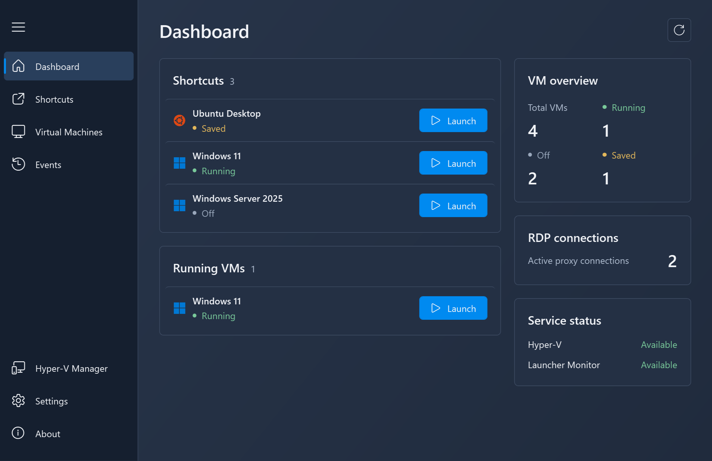
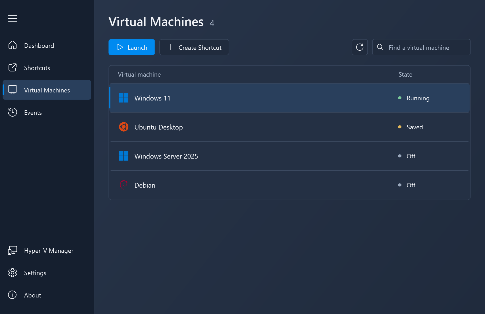
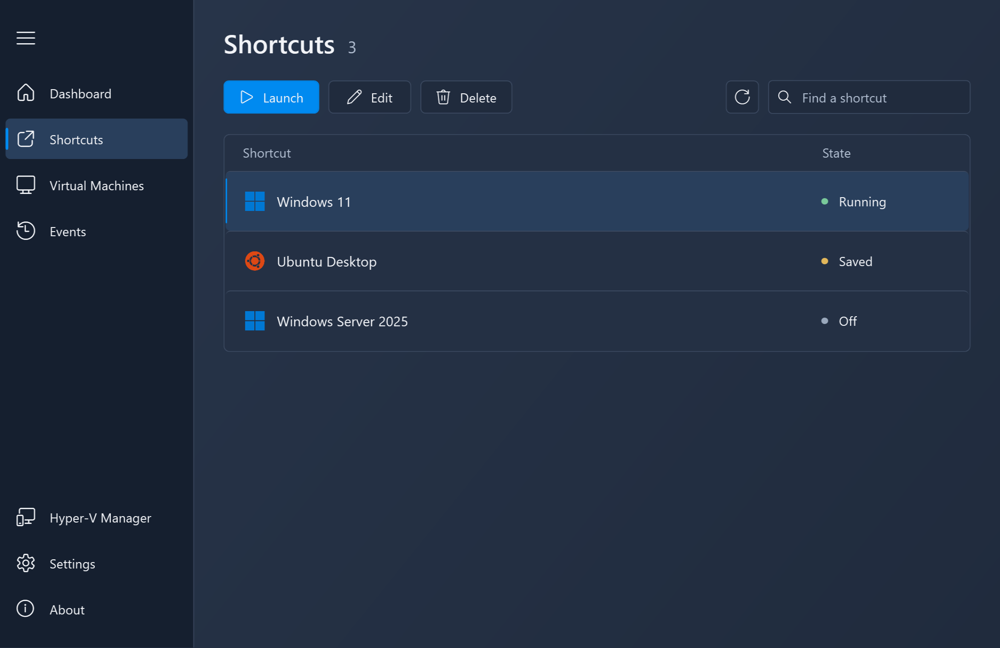
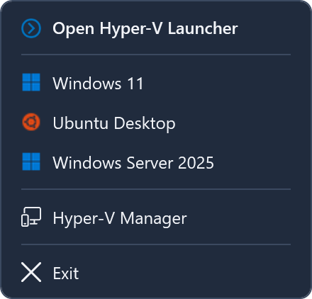
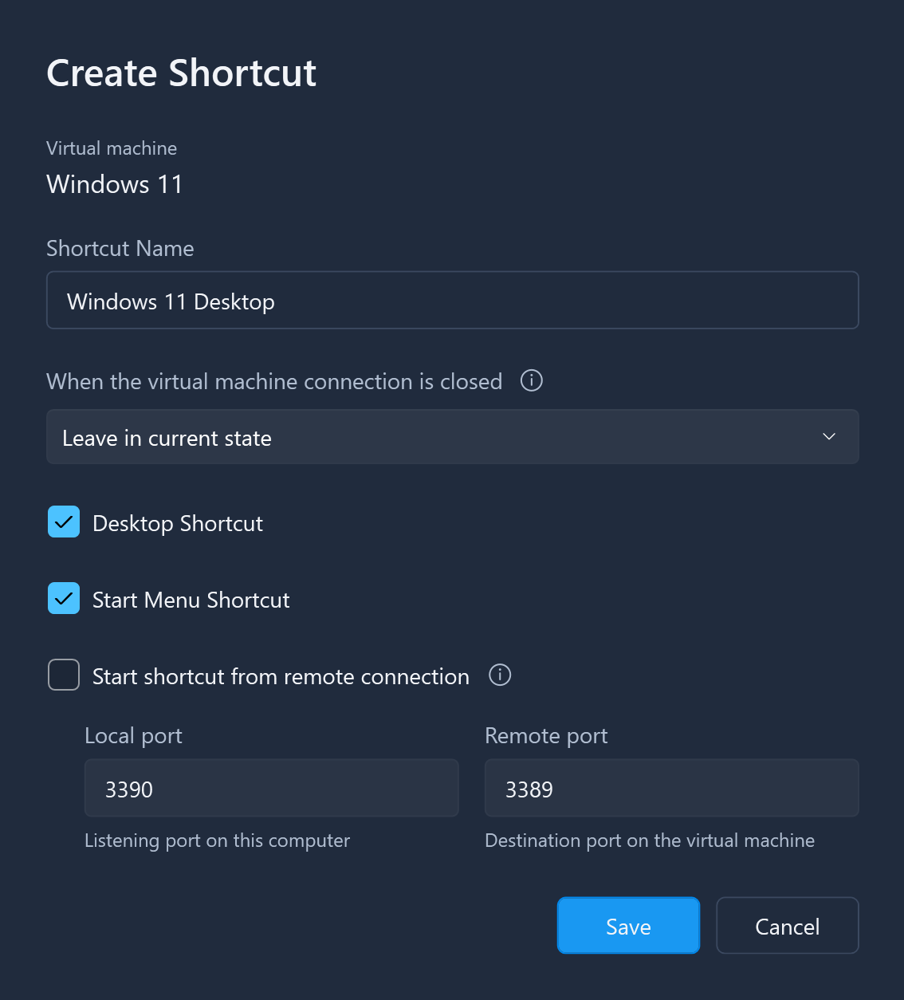
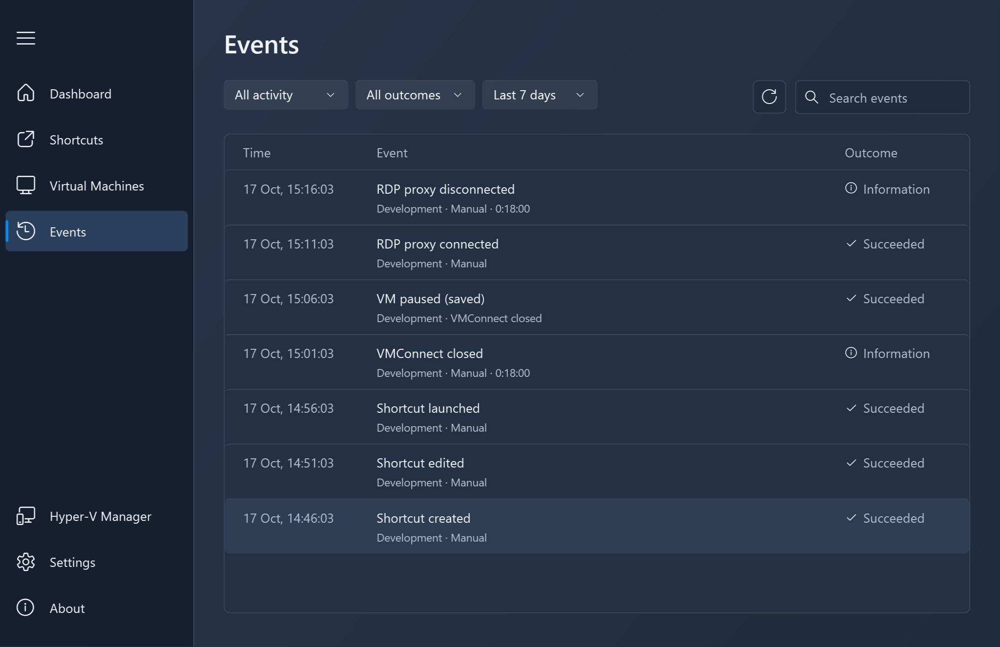

# Hyper-V Launcher

**Your virtual machines. Ready when you are.**

Hyper-V Launcher makes your local Hyper-V virtual machines easier to access. Create desktop and Start Menu shortcuts, launch a VM from the system tray, and choose what happens when its connection window closes.

[Download](https://github.com/andrezammit/hypervlauncher-site/releases/latest/download/HyperVLauncher.Setup.exe) · [Visit the website](https://hypervlauncher.andrezammit.com/) · [Read the guide](https://hypervlauncher.andrezammit.com/guide.html)

Version 1.0.6 · Windows x64 · Hyper-V required

[What’s new in 1.0.6](https://hypervlauncher.andrezammit.com/guide.html#version-1-0-6)

Version 1.0.6 adds guided first-shortcut creation from the dashboard, guidance when no VMs exist, collapsible remote connection settings, and dashboard and Events visual refinements.

## Dashboard and VM management

Launch configured shortcuts and running VMs, check VM state totals and active RDP proxy connections, and see Hyper-V and Launcher Monitor availability from the dashboard.

The refreshed Console includes list search, current VM states, guest OS details and icons, context menus, and multiple-selection launching. Select rows with Ctrl or Shift and choose **Launch**. Shortcuts save their guest OS icon at creation; older shortcuts without saved icon metadata use the default icon.

Console and LaunchPad can run without elevation while the installed Monitor service handles privileged operations. Version 1.0.3 also improves standard-user service access, tray responsiveness, logging, and installer reliability.

## Shortcuts where you need them

Give each VM a recognizable shortcut on your desktop, in the Start Menu, or both. Launch it directly, or use the launcher's Shortcuts page to open and manage your configured machines.

## Launch from the system tray

Your configured VM shortcuts are available from the Hyper-V Launcher tray menu. Open a machine without first opening the management window, and enable **Start on Windows login** to keep the tray application available after you sign in.

## Choose what happens next

Each shortcut can leave the VM in its current state, save its state using **Pause the Virtual Machine**, or request a shutdown when its connection window closes.

Choose the action when creating a shortcut or edit an existing shortcut later. See the [guide to close actions](https://hypervlauncher.andrezammit.com/guide.html#close-actions) for behavior and shutdown considerations.

## Start a VM from a remote connection

Expand **Remote connection settings** and enable **Start shortcut from remote connection** on a shortcut to start its VM when a client connects to a chosen port on the Hyper-V host. Hyper-V Launcher forwards the connection to the configured destination port inside the guest.

For Remote Desktop, enable it in the guest, choose an unused host port such as **3390**, and set the remote port to the guest's listening port, usually **3389**. Keep **Hyper-V Launcher Service** running, then connect your Remote Desktop client to the host, for example `my-hyperv-pc:3390`, using the guest's credentials. The guest must be reachable from the host; use a trusted network or VPN for remote access.

The shortcut's close action can also run after remote connections disconnect. See the [remote connection guide](https://hypervlauncher.andrezammit.com/guide.html#remote-connections) for setup, connection readiness, and close-action behavior.

## Keep your shortcuts in sync

In **Settings**, enable automatic shortcut creation for newly detected VMs, or choose to be prompted first. You can also enable cleanup to remove associated shortcuts when a VM is deleted. Settings are saved as you change the checkboxes, and automatic creation and cleanup require **Hyper-V Launcher Service** to be running. For existing VMs, create shortcuts from the **Virtual Machines** page.

## Activity and support

Use **Events** to search and filter VM, shortcut, and connection activity by type, outcome, and time range. Select an event for details.

In **About**, check the installed version or choose **Save support archive** to save available logs and basic system information as a local ZIP. Logs may contain names, paths, and network addresses, so review the archive before sharing. It does not collect settings, activity databases, or VM files, and is not sent automatically. See the [support guide](https://hypervlauncher.andrezammit.com/guide.html#support).

## Get started

1. Make sure Hyper-V is enabled and your VM is available locally in Hyper-V Manager.
2. [Download the setup](https://github.com/andrezammit/hypervlauncher-site/releases/latest/download/HyperVLauncher.Setup.exe) and install Hyper-V Launcher.
3. Open **Hyper-V Launcher Console** from the Start Menu.
4. Choose **Create your first shortcut** on the dashboard, pick a VM if prompted, then choose its name, destinations, and close action. Click **Create shortcut**. You can also add shortcuts from the **Virtual Machines** page.

The [illustrated guide](https://hypervlauncher.andrezammit.com/guide.html) covers requirements, shortcut creation, close actions, remote connections, automatic shortcut management, and troubleshooting.

[MSI installer](https://github.com/andrezammit/hypervlauncher-site/releases/latest/download/HyperVLauncher.Setup.Installer.msi) · [All releases and release notes](https://github.com/andrezammit/hypervlauncher-site/releases)

Created by [André Zammit](https://andrezammit.com).
