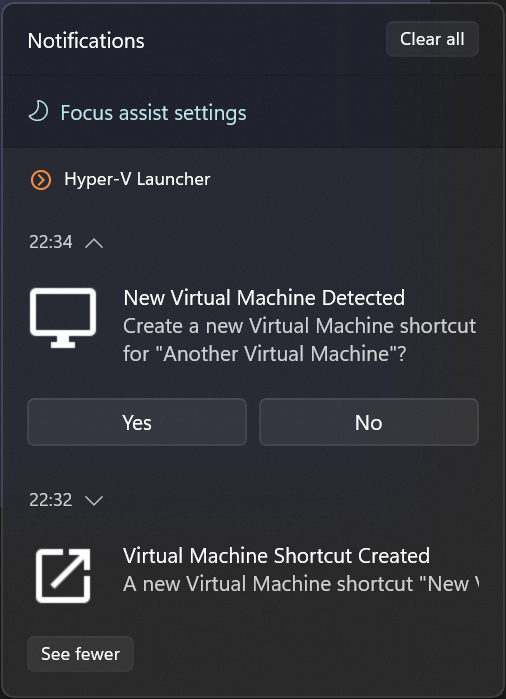

Hyper-V Launcher
----------------

Hyper-V Launcher is an application which makes it easier to access and manage your local Hyper-V Virtual Machines.

Version **1.0.6** · [Website](https://hypervlauncher.andrezammit.com/) · [What’s new and user guide](https://hypervlauncher.andrezammit.com/guide.html#version-1-0-6)

Main Features
-------------

* Dashboard with shortcuts, running VMs, state totals, RDP proxy connections, and service status
* Search VM lists, view guest OS details and icons, and launch multiple selected entries
* Recorded VM, shortcut, and connection activity with search, filters, and event details
* Save a local support archive with logs and basic system information from About
* Monitor service handles privileged operations while Console and LaunchPad run without elevation
* Start a VM from an incoming connection to a configured host port
* Create Desktop shortcuts for Virtual Machines
* Create Start Menu shortcuts for Virtual Machines
* Launch Virtual Machines from the System Tray
* Automatically pause or shut down a Virtual Machine when its window is closed
* Automatically create a shortcut when a Virtual Machine is created in Hyper-V
* Shortcuts are automatically cleaned up if a Virtual Machine is deleted

How to Install and Run Hyper-V Launcher
---------------------------------------
#### Download

[Download the latest setup for Windows x64](https://github.com/andrezammit/hypervlauncher-site/releases/latest/download/HyperVLauncher.Setup.exe)

[Download the MSI installer](https://github.com/andrezammit/hypervlauncher-site/releases/latest/download/HyperVLauncher.Setup.Installer.msi) · [View all releases](https://github.com/andrezammit/hypervlauncher-site/releases)

#### Usage

Hyper-V Launcher is configured through its main application which can be started from the Start Menu. Shortcuts and settings are managed through this application.

#### Creating Shortcuts

To create your first shortcut, choose **Create your first shortcut** on the dashboard. Select a VM if prompted, then choose a name, destinations, and close action and click **Create shortcut**. If no VMs exist, open Hyper-V Manager from the dashboard and create one first.

The Virtual Machines page shows all available local Hyper-V virtual machines. Select one and click on "Create Shortcut".

The shortcut dialog allows you to change the shortcut's name and select whether Desktop and Start Menu shortcuts should be created.
You can also select an action which should be executed after the Virtual Machine window is closed.

#### Launching Shortcuts

Created shortcuts can be launched from the Hyper-V Launcher window itself through the Shortcuts page.

They are also available from the System Tray application context menu.

#### Automatic Virtual Machine Detection

If enabled through the Settings page, Hyper-V Launcher may detect any Virtual Machines which is created or deleted from the system.

When a new Virtual Machine is detected, a Windows notification is presented either allowing you to create a shortcut or notifying you that a shortcut was already created.

When automatic cleanup is enabled, Hyper-V Launcher removes associated shortcuts when a Virtual Machine is deleted. Automatic creation and cleanup require Hyper-V Launcher Service to be running.

License
-------

MIT License

Copyright (c) 2022-2026 Andre Zammit

Permission is hereby granted, free of charge, to any person obtaining a copy
of this software and associated documentation files (the "Software"), to deal
in the Software without restriction, including without limitation the rights
to use, copy, modify, merge, publish, distribute, sublicense, and/or sell
copies of the Software, and to permit persons to whom the Software is
furnished to do so, subject to the following conditions:

The above copyright notice and this permission notice shall be included in all
copies or substantial portions of the Software.

THE SOFTWARE IS PROVIDED "AS IS", WITHOUT WARRANTY OF ANY KIND, EXPRESS OR
IMPLIED, INCLUDING BUT NOT LIMITED TO THE WARRANTIES OF MERCHANTABILITY,
FITNESS FOR A PARTICULAR PURPOSE AND NONINFRINGEMENT. IN NO EVENT SHALL THE
AUTHORS OR COPYRIGHT HOLDERS BE LIABLE FOR ANY CLAIM, DAMAGES OR OTHER
LIABILITY, WHETHER IN AN ACTION OF CONTRACT, TORT OR OTHERWISE, ARISING FROM,
OUT OF OR IN CONNECTION WITH THE SOFTWARE OR THE USE OR OTHER DEALINGS IN THE
SOFTWARE.
